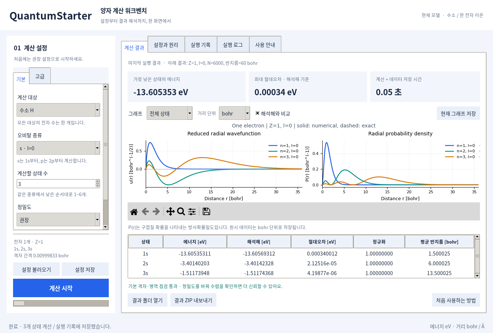

# QuantumStarter v0.2 · 양자 계산 워크벤치

> 보관 문서: 아래 설명은 `python app.py --hydrogen-check`로 여는 기존 한 전자 검증기에 해당합니다.
> 현재 기본 화면은 분자 DFT입니다. 최신 실행 안내는 [README_KO.md](../README_KO.md)를 보세요.

설정 파일을 직접 편집하지 않고 대상 선택 → 정밀도 선택 → 계산 시작 → 결과 확인 순서로 사용합니다.
자주 쓰는 설정은 기본 탭에 두고, 수치 계산의 자세한 내용은 고급 탭과 설정과 원리 탭에 유지했습니다.

현재 계산 엔진은 v0.1과 동일한 한 전자 원자의 방사형 슈뢰딩거 방정식입니다.
DFT, SCF, 다전자 원자, 분자, 촉매 표면은 아직 포함하지 않습니다.
사용 화면만 개선했으며 새로운 촉매 계산 기능이 추가된 것은 아닙니다.

## 화면 예시



고급 설정과 계산 원리는 `docs/ui_details.png`에서도 볼 수 있습니다.

## 가장 간단한 실행

압축을 모두 풀고 `start_windows.bat`를 더블클릭하세요.
Python 3.11 또는 3.12가 필요합니다. 최초 실행에는 인터넷으로 계산 라이브러리를 설치합니다.
한번 설치하면 이후에는 라이브러리를 다시 설치하지 않고 창을 엽니다.
Python 설치나 전역 설정을 변경하지 않고 프로젝트 내부 `.venv`에 설치합니다.
자세한 첫 실행 설명은 `START_HERE_KO.md`에 있습니다.

## 화면 사용

| 위치 | 할 수 있는 일 |
| --- | --- |
| 기본 설정 | 수소 H, He+, Li2+ 선택. 오비탈 종류와 상태 수, 정밀도 선택 |
| 고급 설정 | 핵전하 Z, 계산영역 반지름, 내부 격자점을 직접 지정 |
| 계산 결과 | 에너지, 해석해와의 오차, 그래프, 정규화, 평균 반지름 확인 |
| 설정과 원리 | 모델 가정, 방정식, 수치 방법, 수렴 확인법, 마지막 실행 전체 JSON |
| 실행 기록 | 실행별 조건·결과 확인, 과거 조건 불러오기, 결과 폴더 열기 |
| 실행 로그 | 실제 실행 단계와 오류 원인 확인 |
| 사용 안내 | 처음부터 결과를 읽는 방법까지 화면 안에서 확인 |

계산 시작을 누르면 설정을 점검하고 계산 중 중복 실행을 막습니다.
수치 계산과 원시 데이터 저장은 별도 작업 스레드에서 진행하므로 화면을 움직이고 설명을 읽을 수 있습니다.
진행 막대는 실행 중임을 표시하며, 정확한 완료 비율을 뜻하지 않습니다.
계산 중 닫기를 누르면 실행 중인 계산과 저장이 끝난 뒤 창을 닫습니다.

설정을 바꾸면 기존 결과 위에 다시 계산해야 반영된다는 표시가 나옵니다.
표와 그래프는 마지막 실행의 설정에 연결되어 있습니다.
이전 실행을 새 조건의 결과처럼 표시하지 않습니다.

## 정밀도와 고급 설정

빠른 확인은 내부 격자점 2,000개, 권장은 6,000개, 정밀은 12,000개입니다.
대상과 상태 수에 맞춰 계산영역을 대략 n²/Z 크기로 조정합니다.
이 추천은 출발점이며 정확도를 보증하지 않습니다. 실제 오차는 결과 표에서 확인하세요.

기본 설정은 수소 H의 1s, 2s, 3s이며 반지름 60 bohr, 내부 격자점 6,000개입니다.
핵전하 Z=2는 전자 한 개인 He+이며 중성 헬륨이 아닙니다.
p 오비탈을 선택하면 l=1이므로 2p부터 구합니다. 각도 방향의 3차원 오비탈 그림은 아직 없습니다.

고급 탭에서 반지름이나 격자점을 수정하면 직접 설정으로 표시합니다.
다시 기본 탭에서 권장이나 정밀을 선택하면 추천 격자로 돌아갑니다.
설정 불러오기와 설정 저장은 기존 config.json과 호환됩니다.
불러온 수치는 보존되며 실행마다 settings.json으로 함께 저장합니다.

## 그래프와 결과 읽기

실선은 수치해, 점선은 같은 모델의 해석해입니다.
왼쪽은 축약 방사함수 u(r)=rR(r), 오른쪽은 방사확률밀도 P(r)=|u(r)|²입니다.
P(r)dr은 반지름 r~r+dr 구껍질에서 전자를 발견할 확률입니다. 3차원 부피당 확률밀도와 다릅니다.
상태 선택, 해석해 표시, 거리 단위 bohr/Å 전환을 지원합니다.
Å로 전환할 때 함수의 세로축도 함께 변환하여 정규화가 유지됩니다.
그래프 축은 글꼴 호환성을 위해 영문으로 표기합니다. 설명은 화면 안에 한국어로 제공합니다.

표의 절대오차는 고정된 무한 질량 핵이라는 동일 모델의 해석해에 대한 차이입니다.
실험값과의 오차나 DFT의 정확도가 아닙니다.
기본 설정에서 수소 1s 에너지의 절대오차는 약 0.00034 eV입니다.
시간 카드는 수치 계산과 원시 데이터 저장에 걸린 시간이며 그래프 렌더링은 제외합니다.

## 저장과 내보내기

GUI는 매 실행마다 `outputs/runs/실행시각_고유문자열` 폴더를 만듭니다.
기존 실행을 덮어쓰지 않으며 최근 100개까지 실행 기록 탭에서 찾아봅니다.
화면을 닫았다가 다시 열어도 같은 프로젝트의 실행 기록은 유지됩니다.
과거 기록의 전체 JSON을 확인하거나 해당 조건을 불러와 다시 실행할 수 있습니다.
과거의 원시 파동함수 데이터를 화면에 다시 그리는 기능은 아직 없습니다.

| 파일 | 내용 |
| --- | --- |
| settings.json | 재실행 설정 전체 |
| results.json | 모델 가정, 설정, 상수, 버전, 상태별 에너지·오차·정규화·평균 반지름 |
| energies.csv | 엑셀로 볼 수 있는 상태별 결과 |
| radial.csv | 거리별 수치 파동함수·방사확률밀도·해석해, bohr 단위 |
| wavefunctions.png | 실행 시 모든 상태와 해석해를 표시한 기본 그래프 |
| execution.log | 실행 과정과 완료 상태 |

현재 그래프 저장은 상태 필터와 단위 등을 적용한 화면의 그래프를 PNG로 저장합니다.
결과 ZIP 내보내기는 마지막 실행 폴더의 전체 결과를 묶습니다.
필터를 바꾸더라도 원시 데이터와 기본 그래프는 바뀌지 않습니다.

## VS Code에서 개발하기

QuantumStarter 폴더 자체를 열고 Python 인터프리터를 `.venv`로 선택합니다.
F5의 첫 실행 구성은 한글 사용 화면, 두 번째 구성은 명령행 계산입니다.
IDLE을 사용한다면 설치한 라이브러리가 있는 같은 Python 환경에서 app.py를 실행해야 합니다.

수동 설치와 실행은 Windows PowerShell에서 아래와 같습니다.

```powershell
py -3.12 -m venv .venv
.\.venv\Scripts\python.exe -m pip install -r requirements.txt
.\.venv\Scripts\python.exe app.py
```

macOS/Linux에서는 `python3 -m venv .venv` 후 `.venv/bin/python`으로 pip 설치와 app.py 실행을 진행합니다.
Linux에는 배포판의 Python Tk 패키지가 추가로 필요할 수 있습니다.
창 없이 실행하려면 기존 명령을 그대로 사용할 수 있습니다.

```powershell
.\.venv\Scripts\python.exe main.py --no-show
.\.venv\Scripts\python.exe -m unittest -v
```

명령행 버전은 기존처럼 기본 `outputs` 경로를 갱신합니다. 실행별 경로가 필요하면 `--output`을 지정하세요.
수치 해석 상세와 추가 공부 내용은 `MODEL_REFERENCE_KO.md`에 보존했습니다.

## 코드 구조와 다음 단계

- app.py: 한국어 UI, 비동기 실행, 그래프 필터, 기록, 내보내기.
- solver.py: 기존의 수소형 원자 유한차분 계산 엔진. 이번 변경에서 수정하지 않음.
- workflow.py: 설정 검증, 추천값, 결과 저장, 실행 기록. GUI와 CLI가 공유.
- plotting.py: 내장 그래프와 파일 출력을 공유. 거리 단위 변환 포함.
- main.py: 기존 명령행 실행.
- test_solver.py, test_workflow.py, test_gui.py: 알려진 해, 수렴, 재현성, 단위 변환 검증.

다음 개발에서는 이 계산 엔진과 테스트를 유지하며 구대칭 헬륨 SCF/DFT를 별도 모듈에 추가하면 됩니다.
그때도 입력, 실행, 오차 확인, 저장이라는 화면 흐름을 이어서 사용할 수 있도록 분리했습니다.

## 검증 범위

Python 3.12, NumPy 2.3.5, SciPy 1.17.0, Matplotlib 3.10.8 환경에서 계산과 저장을 검증합니다.
수치 모델·저장·단위 변환·실제 GUI 흐름을 포함한 14개 검증을 통과했습니다.
GUI는 Linux 가상 화면에서 실제 창을 열어 실행, 결과 표시, 설정 전환, 내보내기, 오류 복구와 종료 동작을 확인했습니다.
Windows 배치 파일은 이 환경에서 직접 실행할 수 없으므로 실제 Windows 설치 동작은 별도 확인이 필요합니다.

공식 기술 참고: [Python Tkinter](https://docs.python.org/3/library/tkinter.html),
[Matplotlib GUI 내장](https://matplotlib.org/stable/gallery/user_interfaces/index.html).
