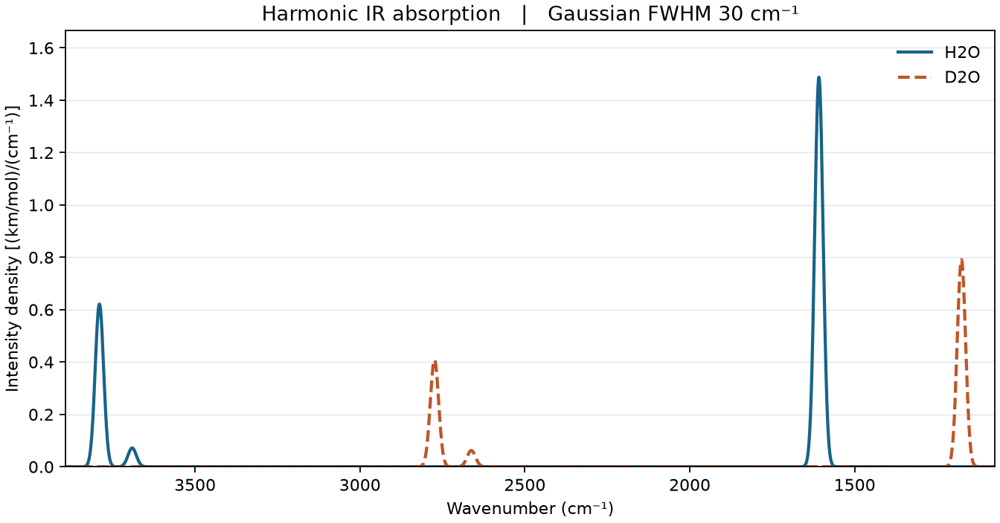

# 물과 중수의 적외선 스펙트럼

같은 평형 구조에서 수소를 중수소로 바꾸면 세 진동 모두 낮은 파수로 이동한다. 가장 강한 굽힘 모드의 조화 적분 세기는 H₂O의 47.515에서 D₂O의 25.263 km/mol로 줄었다. 아래는 자체 PBE-D4/def2-SVP 계산값이다. [예제 입력](../examples/water_ir_reference.json) · [전체 정밀도 비교표](validation/water_ir_comparison.csv)



| 모드 | H₂O 파수 (cm⁻¹) | H₂O 세기 (km/mol) | D₂O 파수 (cm⁻¹) | D₂O 세기 (km/mol) |
| --- | ---: | ---: | ---: | ---: |
| 굽힘 | 1608.48 | 47.515 | 1176.41 | 25.263 |
| 대칭 신축 | 3690.73 | 2.292 | 2662.39 | 1.985 |
| 비대칭 신축 | 3790.01 | 19.851 | 2774.07 | 13.034 |

## 실행과 출력

분자 화면의 **혼합기체 / 계산 비교 → 동위원소 진동수 · IR**에서 **물 예제 → 비교**를 누른다. 새 분자 진동수 계산을 완료하면 기본 분석 그림으로 해당 분자의 IR 스펙트럼이 표시된다. 다른 진동수 결과는 **파일 선택**으로 연다. 치환 칸을 비우면 모든 H를 D로 바꾸고, 원자 순번과 질량을 지정하면 일부 원자만 바꾼다.

```powershell
.\.venv\Scripts\python.exe main.py isotopes examples/water_ir_reference.json --deuterate --fwhm 30
.\.venv\Scripts\python.exe main.py isotopes examples/water_ir_reference.json --mass 2=2.01410177812
```

결과 폴더의 `modes.csv`에는 기준·치환 모드 번호, 파수, 모드 겹침, 적분 세기가 들어간다. `infrared.csv`는 두 곡선의 파수별 세기 밀도, `infrared.png`는 그림, `isotopes.json`은 질량·ZPE·선폭·기준 파일 해시를 담는다. 파수 축은 높은 값부터 표시한다. 그래프는 면적이 1인 가우스 함수에 각 피크의 적분 세기를 곱한다. 선폭을 바꾸면 높이와 폭이 달라지며 표의 적분 세기는 같다.

축퇴된 모드는 개별 모드의 방향 선택에 따라 세기가 나뉠 수 있으므로 같은 파수의 세기 합으로 비교한다. 0.11.1까지 저장된 진동수 결과에는 쌍극자 미분이 없다. 이 파일은 진동수·ZPE 비교에 사용할 수 있다. 기존 입력 설정으로 새 진동수 계산을 한 번 실행하면 이후에는 같은 결과로 여러 동위원소 조합의 IR 세기를 구할 수 있다.

## 계산 방법과 검증

각 원자의 x, y, z 방향으로 ±h만큼 변위시켜 힘을 계산할 때, 같은 수렴 밀도로 전체 분자 쌍극자 μ를 구한다. 모든 변위의 원점은 고정된 실험실 좌표 (0, 0, 0)이다. 비상대론 경로는 핵의 기여에서 전체 전자밀도와 위치 적분의 수축을 뺀다. UKS는 두 스핀 밀도의 합을, ECP는 유효 핵전하를 사용한다. 외부 scalar X2C 경로는 PySCF의 표현 변환 보정이 적용된 쌍극자 연산자를 사용한다. D4는 이 예제의 힘·헤시안에 기여한다. [PySCF 쌍극자 정의](https://pyscf.org/_modules/pyscf/scf/hf.html#dip_moment)

중앙차분 텐서 D = ∂μ/∂R의 행은 쌍극자의 세 성분이고 열은 입력 원자 순서의 3N개 좌표다. 각 동위원소에 대해 병진·회전을 제거하고 질량 정규화한 모드 L(질량 단위 u)에 투영한다. 적분 세기는 약 974.88011 × |D L|² km/mol이다. 양의 파수만 스펙트럼에 포함하며 허수 모드의 세기는 비워 둔다. 이 계산은 조화 진동과 일차 쌍극자 미분을 사용한다. 가우스 선폭은 표시용이며 실험 선폭·비조화 배음·회전 미세구조는 따로 모델링해야 한다. [Psi4 모드 투영과 단위 변환](https://psicode.org/psi4manual/1.10.x/_modules/qcdb/vib.html) · [Porezag와 Pederson의 DFT 적외선 계산](https://doi.org/10.1103/PhysRevB.54.7830)

- **수치 민감도.** 이전에 최적화한 물 구조, 자체 PBE-D4/def2-SVP, 격자 수준 3, SCF 에너지 허용오차 10⁻¹¹ Ha를 사용했다. 변위 h를 0.005에서 0.0025 bohr로 줄였을 때 두 동위원소의 여섯 모드에서 최대 변화는 파수 0.045 cm⁻¹, 세기 0.000169 km/mol이었다.
- **독립 구현 대조.** 같은 헤시안을 PySCF로 질량별 대각화하고, 얻은 정상모드 방향으로 직접 ±0.0025 bohr·√u만큼 움직여 외부 RKS로 쌍극자를 다시 계산했다. ASE의 Debye/Å 단위 환산을 적용한 기준 세기와 최대 차이는 0.00130 km/mol이었다. 이 대조는 조화 모델의 구현을 검사한다. 기체 실험 기본진동과의 파수 차이는 별도 표에 있다. [기체 관측 파수 대조](VALIDATION_KO.md#물의-동위원소-진동수-비교)
- **대칭성.** 결합 길이 0.750 Å의 중성 H₂는 자체 PBE/def2-SVP에서 1.09×10⁻²³ km/mol이었다. 동핵 이원자 분자의 신축 모드가 전기쌍극자 IR에서 비활성이라는 선택규칙과 일치한다.

위 세 검증을 재현하려면 프로젝트 루트의 WSL에서 아래 명령을 실행한다. 각 실행은 `outputs/ir_validation/`에 새 폴더를 만든다. [검증 코드](../scripts/validate_infrared.py)

```bash
OMP_NUM_THREADS=1 OPENBLAS_NUM_THREADS=1 .venv-dft/bin/python scripts/validate_infrared.py
```
