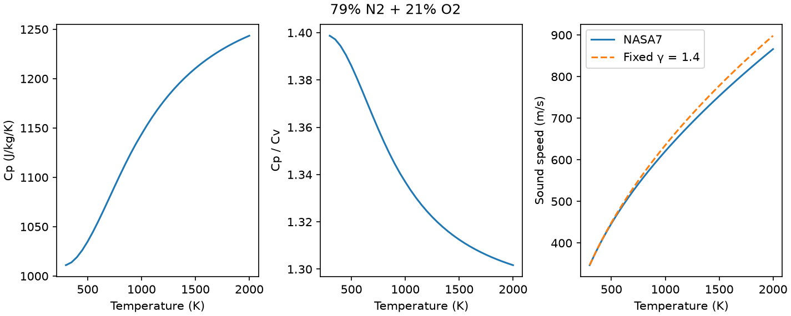

# 혼합기체 음속과 분자 DFT 계산 조건 비교

질소 79 mol%·산소 21 mol%의 고정 조성 이상기체에서, 온도별 비열을 적용한 2,000 K 음속은 **866.17 m/s**다. 같은 조성에서 비열비 γ를 1.4로 고정하면 **898.29 m/s**로 3.71% 높다. 아래 값은 QuantumStarter의 PBE/def2-TZVP 기체 열물성을 1 bar에서 두 구간으로 적합한 NASA7 계수로 계산했다. [입력 계수](validation/nasa7.yaml) · [36개 온도의 비열과 음속](validation/air_sound_speed.csv)

| 온도 (K) | Cp (J/kg/K) | γ | 온도별 비열 적용 (m/s) | γ=1.4 적용 (m/s) | 상대 편차 |
| ---: | ---: | ---: | ---: | ---: | ---: |
| 300 | 1,011.06 | 1.39868 | 347.74 | 347.91 | +0.05% |
| 1,000 | 1,143.69 | 1.33687 | 620.70 | 635.19 | +2.33% |
| 2,000 | 1,243.51 | 1.30167 | 866.17 | 898.29 | +3.71% |



## 화면과 CLI

`start_windows.bat`로 분자 화면을 열고 **혼합기체 / 계산 비교**를 선택한다.

- **혼합기체 비열·음속**에서 몰분율을 입력하고 **계산**을 누른다. 기본값은 `N2=0.79,O2=0.21`이다. 결과를 그래프와 표로 확인할 수 있고, 결과 폴더에는 `mixture.csv`, 그래프 PNG, 사용 계수를 포함한 `mixture.json`이 저장된다.
- **기저·격자 비교**는 분자 화면의 구조와 계산 종류를 그대로 사용한다. 예를 들어 분자 화면에서 **UV–Vis · 물**을 선택한 뒤 이 탭에 기저와 격자 목록을 입력하고 **비교 시작**을 누른다. 개별 실행 시간과 물성 변화량을 각 탭에서 확인할 수 있다.

```powershell
.\.venv\Scripts\python.exe main.py gas-mixture --mix "N2=0.70,O2=0.20,CO2=0.10"
.\.venv\Scripts\python.exe main.py basis-grid --xyz examples/water.xyz --calculation uvvis --bases def2-svp def2-tzvp --grids 2 3
.\.venv\Scripts\python.exe main.py basis-grid --xyz examples/water.xyz --calculation frequencies --bases def2-svp def2-tzvp --grids 2 3
.\.venv\Scripts\python.exe main.py basis-grid --xyz examples/h2.xyz --calculation spin_scan --scan "distance 1 2 1.4 2.0 3" --bases def2-svp def2-tzvp --grids 2 3
```

두 명령 모두 `--output`으로 결과 상위 폴더를 지정할 수 있다. `gas-mixture --coefficients`에는 QuantumStarter가 내보낸 단일종 NASA7 파일 여러 개 또는 합본 파일을 지정한다. 기본 계수로 계산할 때는 추가 SCF나 Cantera 설치가 필요하지 않다. `basis-grid --config`로 전체 분자 JSON 설정을 전달하면 전하·스핀·수렴 기준도 보존된다.

## 물리 모형과 독립 검증

몰분율을 xᵢ, 몰질량을 Mᵢ라 하면 Cₚ = ΣxᵢCₚ,ᵢ, Cᵥ = Cₚ − R, γ = Cₚ/Cᵥ이다. 음속은 a = √(γRT/M), 혼합 몰질량은 M = ΣxᵢMᵢ이다. 여기서 두 열용량은 몰 단위이고 M은 kg/mol이다. 질량 단위 환산에는 자연 원소의 관용 원자량을 사용한다. 양의 상대 편차는 100(a₁.₄/a − 1)이다. 모형은 온도에 따라 내부 자유도가 열평형에 도달하고, 음파가 지나는 동안 화학 조성은 고정된다고 가정한다. 해리·화학 평형에 따른 조성 변화와 주파수별 진동 완화는 이 계산의 범위 밖이다.

Cantera 3.2.0에서 같은 NASA7 파일을 읽고 이상기체상을 구성했다. 순수 N₂·O₂·CO₂, 79/21 혼합물, 70/20/10 혼합물을 각각 38개 온도에서 검사했다. 계수 구간 경계인 1,000 K와 양옆 999.99 K, 1,000.01 K를 포함한다. 총 190조건에서 질량 정압비열의 최대 차이는 6.83×10⁻¹³ J/(kg·K), 음속은 2.28×10⁻¹³ m/s 이하였다. 이 검사는 주어진 계수의 해석과 혼합 계산을 검증한다. 원래 DFT 열물성의 NIST 대조 결과는 별도로 제공한다. [Cantera 비교표](validation/mixture_cantera.csv) · [Cantera 열물성 정의](https://cantera.org/stable/python/thermo.html) · [기체별 NIST 대조](MOLECULAR_SUITE_KO.md)

## 기저와 적분 격자를 바꾼 결과

자체 PBE에서 def2-SVP·def2-TZVP와 격자 수준 2·3을 조합했다. 물의 좌표는 `examples/water.xyz`에 고정하고 H₂는 동일한 1.4–2.0 Å 스캔을 반복했다. 아래 표는 격자 수준 3에서의 기저 변화다. [모든 조건·물성·실행 시간](validation/molecular_basis_grid.csv)

| 물성 | def2-SVP | def2-TZVP | 변화량 |
| --- | ---: | ---: | ---: |
| 물의 첫 단일항 TDA 피크 (eV) | 7.33146 | 7.20010 | −0.13136 |
| 물의 최저 조화 진동수 (cm⁻¹) | 1,534.85 | 1,548.13 | +13.29 |
| H₂ 스핀 분기 구간 중앙 (Å) | 1.61782 | 1.61987 | +0.00205 |

H₂의 각 분기 구간 폭은 약 0.000293 Å였다. 두 기저 각각에서 격자 수준 2 → 3 변화는 같은 이분 구간 안에 머물렀다. 기본 보고서는 `runs.csv`에 하위 실행 경로와 프로세스 시작·저장 시간을 포함한 경과 초를, `differences.csv`에 한 축만 바꾼 인접 조건의 부호 있는 차이(다음 − 이전)를 쓴다. `comparison.json`에는 입력, 개별 측정값 및 상태가 함께 들어간다. 시간은 해당 실행 환경과 동시 부하의 영향을 받는다.

UV–Vis 피크는 에너지 순번, 진동수는 부호 있는 주파수 순번으로 비교한다. 준위가 교차하면 같은 순번의 상태나 모드 성격이 바뀔 수 있다. 스핀 분기 개수가 달라지면 구간 위치의 변화량은 비워 둔다. `completed`는 요청한 계산이 모두 끝났다는 뜻이며 기저 완비성 또는 특정 오차 허용범위 달성을 판정하지 않는다. 일부 계산이 실패하면 `incomplete`와 해당 하위 실행 경로를 남기고, 차이는 성공한 이웃 조건 사이에서만 계산한다.

### 음속까지 전파된 계산 조건의 영향

각 조건에서 N₂ 단일항과 O₂ 삼중항을 개별적으로 최적화하고 조화 진동수, RRHO 표, NASA7 계수를 다시 구했다. 그 계수로 같은 79/21 혼합물을 계산했다. 2,000 K 음속은 네 조건에서 **866.173–866.362 m/s**였고, 전체 온도 표에서 조건 간 최대 폭은 **900 K에서 0.3422 m/s**였다. 이는 선택한 두 기저와 두 격자에서 관찰한 민감도다. 함수 선택·비조화성·실제 기체의 오차까지 추정하려면 별도 대조가 필요하다. [네 조건의 144개 온도별 행](validation/air_basis_grid.csv)

프로젝트 루트에서 다음 명령으로 두 검증을 재현할 수 있다. 첫 명령은 Cantera를 설치한 Python에서 실행한다. 두 번째 명령은 프로젝트 WSL DFT 환경과 새 출력 경로를 사용한다.

```bash
python scripts/validate_gas_mixture.py
OMP_NUM_THREADS=1 OPENBLAS_NUM_THREADS=1 .venv-dft/bin/python scripts/validate_air_sensitivity.py --out outputs/my_air_dft --backend local
```
