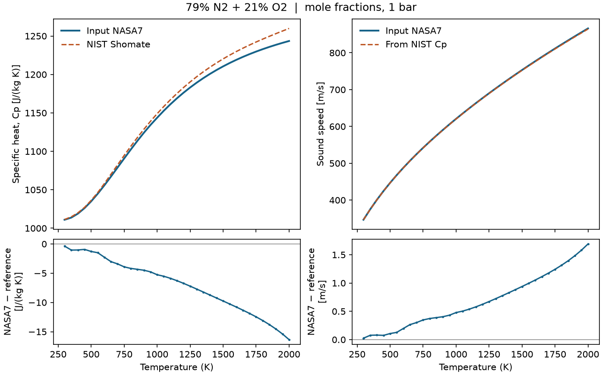

# 질소·산소 혼합물의 정압 비열과 음속 검증

몰분율 N₂ 0.79, O₂ 0.21의 이상기체를 1 bar에서 계산했다. 2,000 K에서 자체 DFT 계수의 정압 비열은 NIST 기준보다 **16.354 J/(kg·K) 낮고**, 음속은 **1.691 m/s 높다**. 두 물성 모두 검사한 36점 중 이 온도에서 차이가 가장 컸다. 기준 비열은 NIST의 순수 기체 열용량을 혼합한 값이고, 기준 음속은 그 비열로 계산한 값이다. [온도별 대조표](validation/air_reference_comparison.csv) · [최대 편차와 온도](validation/air_reference_extrema.csv)



## 온도별 결과

비열은 J/(kg·K), 음속은 m/s다. Δ는 자체 NASA7 값에서 기준값을 뺀 값이다. 상대 편차의 분모는 해당 온도의 기준값이다.

| 온도 (K) | NASA7 비열 | NIST 비열 | Δ비열 | NASA7 음속 | NIST 비열로 유도한 음속 | Δ음속 |
| ---: | ---: | ---: | ---: | ---: | ---: | ---: |
| 298.15 | 1,011.005 | 1,011.352 | −0.347 | 346.673 | 346.649 | +0.024 |
| 500 | 1,034.938 | 1,036.225 | −1.287 | 446.884 | 446.777 | +0.107 |
| 700 | 1,078.904 | 1,082.314 | −3.410 | 524.650 | 524.350 | +0.301 |
| 1,000 | 1,143.687 | 1,148.948 | −5.261 | 620.703 | 620.225 | +0.478 |
| 1,500 | 1,210.488 | 1,220.239 | −9.752 | 753.233 | 752.295 | +0.939 |
| 2,000 | 1,243.509 | 1,259.863 | −16.354 | 866.173 | 864.482 | +1.691 |

298.15 K 한 점과 300–2,000 K의 50 K 간격 점들에서 절대 편차와 상대 편차의 크기를 각각 비교했다. 표에는 각 최대점에서의 부호를 표시했다.

| 물성 | 기준 | 최대 절대 편차 지점의 Δ | 온도 (K) | 최대 상대 편차 지점의 Δ (%) | 온도 (K) |
| --- | --- | ---: | ---: | ---: | ---: |
| 몰 정압 열용량 | NIST Shomate | −0.47182 J/(mol·K) | 2,000 | −1.2981 | 2,000 |
| 질량 정압 비열 | NIST Shomate | −16.35397 J/(kg·K) | 2,000 | −1.2981 | 2,000 |
| 음속 | NIST 비열에서 유도 | +1.69095 m/s | 2,000 | +0.1956 | 2,000 |

## 계산 조건과 출처

자체 계산은 PBE/def2-TZVP, 적분 격자 수준 4, 힘 중심차분 간격 0.005 bohr에서 구한 진동수를 사용했다. N₂는 단일항, O₂는 삼중항이다. 강체 회전자·조화 진동자(RRHO) 모형의 몰 정압 열용량을 298.15–1,000 K와 1,000–2,000 K의 NASA7 다항식에 적합했다. [입력 계수](validation/nasa7.yaml) · [분자별 조건과 열물성](MOLECULAR_SUITE_KO.md)

독립 기준은 NIST Chemistry WebBook SRD 69에 실린 Chase(1998)의 기체상 Shomate 계수다. 각 기체에 대해 `t = T/1000`과 `Cp = A + B·t + C·t² + D·t³ + E/t²`를 사용했다. N₂는 500 K, O₂는 700 K, 선택 가능한 CO₂는 1,200 K부터 다음 계수를 사용한다. N₂와 O₂의 2,000 K 값에는 그 온도에서 끝나는 구간의 계수를 적용했다. [N₂ 계수](https://webbook.nist.gov/cgi/cbook.cgi?ID=C7727379&Mask=1#Thermo-Gas) · [O₂ 계수](https://webbook.nist.gov/cgi/cbook.cgi?ID=C7782447&Mask=1#Thermo-Gas) · [CO₂ 계수](https://webbook.nist.gov/cgi/cbook.cgi?ID=C124389&Mask=1#Thermo-Gas)

두 계산에서 몰분율, 몰질량, 기체상수와 혼합식을 같게 했다. 혼합 몰질량은 0.02885064 kg/mol이다. 아래 식에서 Cp와 Cv는 몰 열용량이며, 질량 정압 비열은 Cp를 혼합 몰질량 M으로 나눈 값이다.

    Cp = Σ xᵢ Cpᵢ       Cv = Cp − R       γ = Cp / Cv
    a = √(γ R T / M)

비열이 작아지면 같은 T와 M에서 γ가 커지므로 음속의 편차는 비열과 반대 방향으로 나타난다. 음속식은 화학 조성이 고정되고 분자의 내부 자유도가 열평형을 따르는 저주파 이상기체 한계에 해당한다. 이 식에서는 1 bar의 압력이 소거된다. 실제 기체의 밀도 효과, 화학적 해리와 음향 주파수에 따른 진동 완화는 이 계산 범위 밖이다.

## 기준값 교차 확인과 음속 실험의 범위

298.15, 500, 700, 1,000, 1,200, 2,000 K에서 NIST-JANAF의 N₂·O₂ **표 수치**만으로 79/21 혼합물을 다시 계산했다. Shomate 다항식으로 구한 기준과의 최대 차이는 몰 열용량 0.00545 J/(mol·K) 미만, 유도 음속 0.0182 m/s 미만이었다. 이는 같은 열화학 자료집의 표와 적합식을 대조한 결과다. 순수 CO₂의 표와 세 기체의 계수 전환점도 테스트에 포함했다. [N₂ JANAF 표](https://janaf.nist.gov/tables/N-023.html) · [O₂ JANAF 표](https://janaf.nist.gov/tables/O-029.html) · [CO₂ JANAF 표](https://janaf.nist.gov/tables/C-095.html)

검토한 FLOMEKO 이원 N₂/O₂ 음속 실험은 대기압 부근의 19–20 °C(292.15–293.15 K)에서 수행됐다. Meier·Kabelac의 240–420 K 정밀 측정은 아르곤을 포함한 삼원 합성 공기를 사용했다. 두 자료에서 이번 79/21 이원계의 조성·온도·압력에 맞는 직접 측정점을 확보하지 못했다. 따라서 위 0.1956%는 열용량에서 유도한 음속 사이의 상대 편차다. [FLOMEKO 실험과 조건](https://www.imeko.org/publications/tc9-2003/IMEKO-TC9-2003-027.pdf) · [Meier·Kabelac 측정 자료](https://trc.nist.gov/ThermoML/10.1021/acs.jced.6b00720.html)

## 재현

Windows 프로젝트 폴더에서 아래 명령을 실행한다. 분자 GUI에서는 **혼합기체 / 계산 비교 → 혼합기체 비열·음속 → 계산**을 누른 뒤 **NIST 비교 그림** 또는 **NIST 대조표**를 연다.

```powershell
.\.venv\Scripts\python.exe main.py gas-mixture --mix "N2=0.79,O2=0.21" --output outputs/mixture_reference
.\.venv\Scripts\python.exe -m unittest test_mixture_reference test_molecular_studies
```

새 실행 폴더의 `reference_comparison.csv`는 온도·압력·몰분율별 비열과 음속 및 편차를, `reference_extrema.csv`는 기준 종류·단위·범위와 최대 편차의 온도를 담는다. `reference_comparison.png`는 두 곡선과 편차를 표시한다. `mixture.json`에는 프로그램 버전, 사용한 NASA7 계수, 기체별 NIST 출처와 전환 온도가 들어간다. 다른 NASA7 계산과 대조하려면 같은 명령에 `--coefficients`와 기체 계수 파일 경로를 추가한다.
