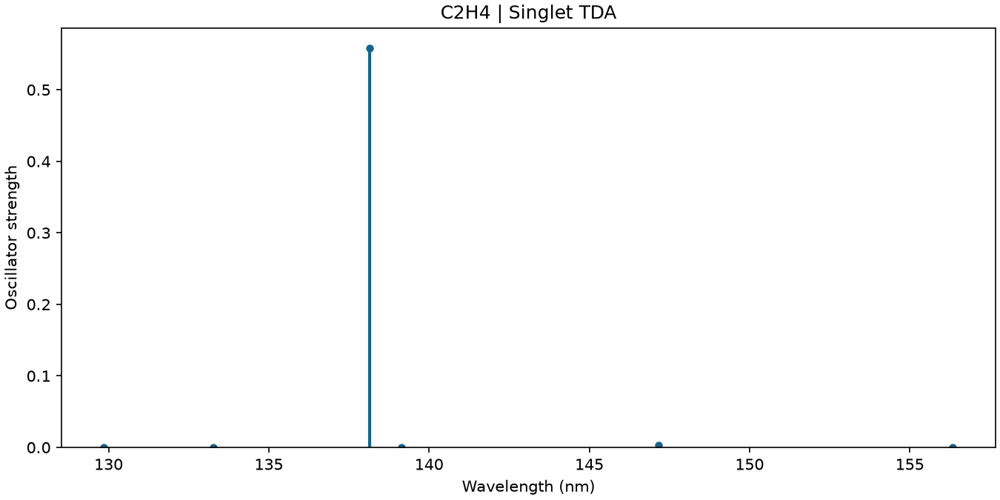

# UV–Vis, 기체 열물성, 결합 해리 계산

QuantumStarter 0.10.0의 분자 화면에서 예제를 선택하고 **계산 시작**을 누르면 분석 그래프가 열린다. UV–Vis 예제의 **UV–Vis 피크** 탭에는 상태별 에너지와 파장, 진동자 세기, 가장 큰 전이 기여율이 표시된다. 실행 폴더에는 수치 표와 `molecular.png`가 저장된다.

| 계산 종류 | 화면 예제 | 결과 파일 |
| --- | --- | --- |
| `uvvis` | UV–Vis · 물 | `uvvis.csv`, `results.json`의 전이 쌍극자·궤도 기여 |
| `gas_thermo` | 기체 열물성 · N₂ / O₂ / CO₂ | `gas_thermo.csv`, `nasa7.yaml` |
| `spin_scan` | 스핀 해리 · H₂ | `spin_scan.csv`, `results.json`의 부호 전환 구간 |

프로젝트 루트의 Windows PowerShell에서 다음 예제를 실행할 수 있다. GUI는 `start_windows.bat`로 연다. 세 기능은 DFT 환경(PySCF·Libxc)을 사용하고, 기체 열물성 계산은 구조 최적화를 위해 geomeTRIC도 사용한다.

```powershell
.\.venv\Scripts\python.exe main.py --xyz examples/water.xyz --calculation uvvis --states 6 --no-show
.\.venv\Scripts\python.exe main.py --xyz examples/n2.xyz --calculation gas_thermo --basis def2-tzvp --no-show
.\.venv\Scripts\python.exe main.py --xyz examples/h2.xyz --calculation spin_scan --scan "distance 1 2 1.5 2.0 6" --no-show
```

## UV–Vis 피크 읽기

고정 핵 좌표에서 자체 닫힌껍질 RKS의 점유·가상 궤도로 단일항 Tamm–Dancoff 근사(TDA)를 푼다. 길이 게이지 전이 쌍극자로 무차원 진동자 세기 *f*를 구한다. 막대의 높이는 *f*이며, 주요 전이의 기여율은 정규화한 전이 진폭의 제곱이다. 궤도 번호는 1부터 시작한다. `--states`는 1–100이며 가능한 점유–가상 조합 수까지 반환한다.

동일한 구조·def2-SVP·격자 수준 3에서 독립 PySCF의 전체 TDA 행렬을 대각화하고 첫 6개 상태씩 비교했다. 예를 들어 에틸렌의 가장 밝은 피크는 계산한 6개 가운데 4번으로, 138.15 nm, *f* = 0.55848이며 MO 8 → 9의 기여율이 90.6%다. 아래 오차는 두 구현 사이의 차이다. 실험 흡수 파장과 비교하려면 기저·함수·진동 구조·환경의 영향도 고려해야 한다. [24개 피크와 독립 기준값](validation/uvvis_comparison.csv) · [PySCF 단일항 응답 및 세기 정의](https://pyscf.org/_modules/pyscf/tdscf/rhf.html)

| 분자 | 함수 | 최대 에너지 차이 (eV) | 최대 진동자 세기 차이 |
| --- | --- | ---: | ---: |
| 물 | PBE | 4.75×10⁻⁹ | 8.44×10⁻¹¹ |
| 포름알데히드 | PBE | 7.58×10⁻⁹ | 1.55×10⁻¹⁰ |
| 에틸렌 | PBE | 2.55×10⁻⁹ | 3.89×10⁻¹² |
| 물 | PBE0 | 3.65×10⁻⁹ | 5.99×10⁻¹¹ |



## 기체 열물성과 NASA7 사용

N₂·CO₂는 단일항, O₂는 삼중항으로 평형 구조와 조화 진동수를 구한다. 표는 1 bar에서 이상기체·강체 회전자·조화 진동자(RRHO) 모형의 정압 열용량 *Cₚ*, 298.15 K 대비 엔탈피 증가량 *ΔH*, 절대 엔트로피 *S*를 제공한다. 검증 조건은 자체 PBE/def2-TZVP, 격자 수준 4, 엄격한 구조 수렴, 힘 중심차분 0.005 bohr, 최빈 동위원소 질량, 회전 대칭수 2다. 온도는 298.15 K 및 300–2,000 K의 50 K 간격으로 기체당 36점이다. [온도별 열물성과 NIST 비교](validation/gas_thermo.csv)

| 기체 | NIST 대비 최대 절대 차이 Cₚ (J/mol/K) | ΔH (kJ/mol) | S (J/mol/K) |
| --- | ---: | ---: | ---: |
| N₂ | 0.292 | 0.266 | 0.185 |
| O₂ | 1.148 | 0.637 | 0.364 |
| CO₂ | 0.614 | 0.254 | 0.649 |

NIST 기준은 각 온도 범위의 Shomate 계수를 사용한다. 가장 큰 열용량 차이는 O₂에서 나타났다. RRHO는 비조화 진동과 온도에 따른 들뜬 전자 상태의 점유를 제외한다. [N₂](https://webbook.nist.gov/cgi/cbook.cgi?ID=C7727379&Mask=1) · [O₂](https://webbook.nist.gov/cgi/cbook.cgi?ID=C7782447&Mask=1) · [CO₂](https://webbook.nist.gov/cgi/cbook.cgi?ID=C124389&Mask=1)

NASA7 파일에는 298.15–1,000 K와 1,000–2,000 K의 계수가 들어 있다. 두 구간 경계에서 *Cₚ*, *H*, *S*를 연속으로 맞췄다. *H*(298.15 K)는 N₂·O₂의 경우 0, CO₂의 경우 NIST의 표준 생성엔탈피 −393.5224 kJ/mol이며, *S*(298.15 K)는 1 bar RRHO 값이다. CSV의 ΔH와 비교할 때는 NASA7 엔탈피에서 이 생성엔탈피를 뺀다. 파일은 화학종 정의만 담으며 완전한 반응 메커니즘은 별도로 구성한다. [세 화학종의 NASA7 계수](validation/nasa7.yaml) · [Cantera NASA7 정의](https://cantera.org/stable/reference/thermo/species-thermo.html)

내보낸 다항식을 별도 코드로 적분해 표의 108행을 복원했다. 원래 RRHO 표에 대한 최대 차이는 *Cₚ* 0.0142 J/mol/K, *ΔH* 0.00117 kJ/mol, *S* 0.00320 J/mol/K였다. 적합에 쓰지 않은 이웃 온도의 중간점에서도 세 물성 차이가 각각 0.0132 J/mol/K, 0.00116 kJ/mol, 0.00319 J/mol/K 이하였다.

## 결합 해리와 실수 스핀 안정성

`distance i j 시작 끝 점수`에서 원자 번호는 1부터, 거리는 Å이다. 처음 주어진 *i* → *j* 방향으로 원자 *j*만 움직이고 다른 원자는 고정한다. 각 거리에서 RKS의 α·β 궤도를 반대로 회전시키는 방향의 최저 에너지 곡률을 구한다. 음의 곡률 방향과 이전 거리의 스핀 분리 궤도로 UKS를 시작해 찾은 해 중 더 낮은 수렴 에너지를 저장한다. 곡률 부호가 바뀐 인접 점은 이분법으로 0.0004 Å 이하까지 좁힌다. 이 거리는 선택한 함수와 기저에서의 전자 상태 분기점이다.

| 구조와 스캔 | 부호 전환 구간 (Å) | 마지막 거리의 UKS − RKS (Ha) |
| --- | --- | ---: |
| H₂, H–H 1.50–2.00 Å | 1.617578–1.617969 | −0.014121 |
| H₂O, 한 O–H 0.95–2.30 Å | 1.777051–1.777271 | −0.021611 |

두 계산은 PBE/def2-SVP와 격자 수준 3을 사용했다. H₂ 구간은 이전 독립 PySCF 검증의 분기 추정값 1.61784 Å를 포함한다. 물의 마지막 점에서 ⟨S²⟩는 0.784였다. 스핀 분리 해는 여러 스핀 고유상태 성분을 포함할 수 있으며, 더 낮은 에너지가 전체 바닥상태를 보장하지 않는다. 이 계산은 실수 궤도와 고정 구조 경로를 다룬다. [물의 거리별 결과](validation/water_spin_scan.csv) · [H₂ 독립 기준](validation/h2_scan.csv)

## 검증 재현

프로젝트 루트의 WSL 환경에서 아래 명령을 실행한다. 생성 명령마다 새 출력 폴더를 지정한다.

```bash
OMP_NUM_THREADS=1 OPENBLAS_NUM_THREADS=1 .venv-dft/bin/python -m engines.gas_thermo --out outputs/my_gases
.venv-dft/bin/python scripts/validate_molecular_suite.py --check-gases outputs/my_gases
OMP_NUM_THREADS=1 OPENBLAS_NUM_THREADS=1 .venv-dft/bin/python scripts/validate_molecular_suite.py --out outputs/my_spectra_scan
```
